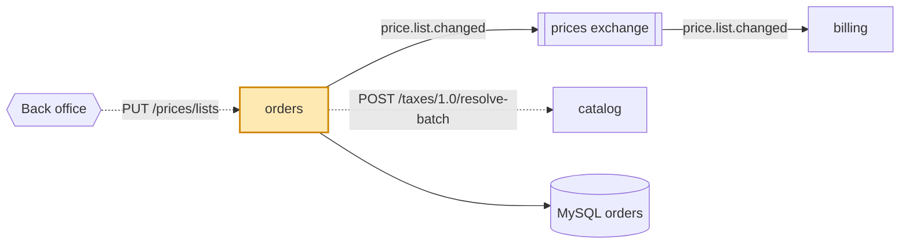

# Service map

Take one service (the workspace folder), find **the flows it offers**, and show
**how it connects to the whole system**: what starts each flow, which services
take part, which messages it sends and who receives them and why, whom it calls,
and what it receives from others. **Find the repos that take part yourself**:
`use_skill` names the **code root** (`../`, every repo beside this one, read
only); the user does not name them. The result is a **service map** in the
map library (`write_service_map`), outside any session, so it can be opened
from anywhere while building or proving a feature.

**Stay on this service.** Its flows are the subject; other repos appear only
where a flow touches them, one level deep, **written in words** (endpoint,
consumer or handler name, what it does there, what it stores or sends next) —
never their own internals as diagrams. A small map that is right beats a big one.

Facts from the code only; anything else marked "(guess)". Real names only:
route, exchange, queue, topic, routing key, event struct, table, config key,
service folder.

## Steps

1. **What was asked.** Either the **whole service** (every flow it offers) or
   **one flow / topic** ("the refund job", "everything around price
   lists"). **The map's name** is given in the request ("Map name: …"); use it
   as is, never ask for one (the user renames maps in the app). No name in
   the request: pass `service` empty and one is chosen (`<session>_mapN`). The service is
   the one the request names, with its folder. For one flow: trace only
   that flow, add or update its block in `flows` (and its row in the flows
   table), and redraw `map` with that flow's path; leave the other docs and
   flows as they are.
2. **Existing map:** `read_service_map` with the map's name. If it exists, update
   it; keep what is still true. When the request says **rebuild**: don't read
   or reuse its content; scan from scratch (keep to what it was made for, when
   the request says it) and write every doc with `rebuild: true`.
3. **Find the flows the service offers** — every entry point is the start of
   a flow: HTTP routes (group by resource: `/prices/lists/*` is one
   flow), message consumers, scheduled workers and workflow tasks. `grep` the
   route and consumer registrations; one line each: trigger → what it achieves.
4. **Find who takes part, across the code root `../`.** For every message
   the flow sends or consumes, take its exchange/topic, routing key and queue
   names; for every call, its route path or client method
   (`/taxes/resolve-batch`, `GetCustomers`). `grep` them in `../`
   with a `glob` for the code (`*.go`; `*.java`, `*.ts`, `*.yaml` when the
   repos use them) — a search over `../` without a glob runs out of time. The
   repos with matches are the senders, receivers, servers and callers (also
   the UI repos that call this service's routes). A shared library only leads
   to the real service: follow its client to the URL or config key that names
   it.
5. **Trace each flow.** Inside this service, in detail: entry point, steps,
   tables read and written, calls, messages (exchange/topic, routing key, event
   struct, key fields). In each other repo found in step 4, **only what the
   flow needs, in words**: the endpoint or consumer that receives it, the
   handler name, what it does with it (its purpose), the tables it touches, and
   what it sends or calls next (one hop; name it, don't follow it further).
   Short `read_file` reads only. For many flows or repos, `run_subagent` one
   repo per helper, asking for these few lines. Also cover what the service
   receives from others (its consumers, routes others call). Not found in
   `../`: "receiver (or sender) not found in the code root".
6. **Write all changed docs in one `write_service_map` call** (service, docs,
   question, and `services`: the folders of the services that take part, e.g.
   `["../billing", "../catalog"]`). The skill's **contract** (`contract.json`, readable with
   `use_skill` file=`contract.json`) is checked before you are asked to
   approve: only its doc names, the required docs on a new map, and each doc's
   required headings, table columns and diagram types. If the call is refused,
   fix exactly what it lists and call again.
7. **Reply** in 2–3 lines: the map's name, the flows found, the gaps.

When the work is about a feature, mark flows, messages and calls with
✅ exists · ✏️ change · 🆕 new (as in the feature docs); otherwise no marks.

## The docs (in this order)

**map** — this service and its direct neighbours. One line: the focus service
and the repos that take part. Then one Mermaid `flowchart LR`:
- the focus service highlighted (`:::focus`), each neighbour repo as one box
  (no boxes for its inside), exchanges/topics as `[[ ]]`, stores as `[( )]`,
  outside systems (UI, back office) as `{{ }}`;
- messages as solid arrows through their exchange/topic, labelled with the
  message name; calls as dashed arrows `-.->` labelled with the route;
- at most ~12 boxes; group minor ones ("3 more services").

**flows** — first a table of every flow the service offers:
`# | Flow | Trigger (route / message / schedule) | What it achieves`. Then one
block per flow (all of them, or those the focus names):
`### N. Flow name — what it achieves`, one line of trigger and result, then a
`sequenceDiagram` whose participants are the trigger, this service, its stores
and each neighbour repo as **one** participant (its steps are not drawn): the
service's steps, every message out and call with its answer (`Note` for
decisions such as a per-tenant switch). Then **In other repos:** one bullet per
repo the flow touches — `billing` — consumer `price.list.changed`
(`HandlePriceListChanged`): recalculates open invoices, writes `invoice_line`,
sends `invoice.updated`. Then one line on what happens when a step fails.

**messages** — one row per message, sends first, then receives:
`Message | Exchange / topic · routing key | Sender (trigger) | Receivers → what
each does with it | Key fields`.

**calls** — synchronous calls in and out: `From | To | Route / RPC | Purpose`.

**services** — one short block per repo that takes part, the focus first: what
it owns, and in words what it does in this service's flows (endpoint and
handler names, tables, what it sends next). Nothing about its other work.

**open-questions** — what the code doesn't answer (unknown receivers, dynamic
routing keys, config-driven topics), one line each.
